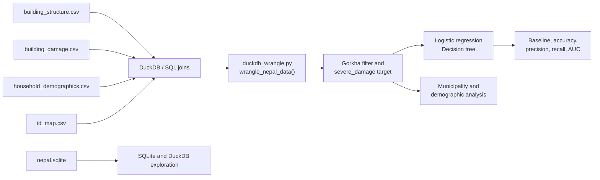

# Nepal Earthquake Damage Classification and Data Analysis

A reproducible SQL and Python project that joins Nepal Earthquake Damage Assessment data, builds a severe-damage classification target, compares baseline and machine-learning models, and investigates geographic and demographic patterns responsibly.

The analysis focuses on buildings in Gorkha district, the earthquake epicentre. It combines DuckDB, relational joins, reusable data preparation, scikit-learn pipelines, model evaluation, and documented limitations.

## Why this project matters

The technical question is whether building characteristics and related household data can help identify severe structural damage. The broader analytical question is how to interpret the results without confusing geographic association with causal demographic effects.

The project starts with the data model rather than jumping directly into modelling. It verifies the source tables, joins them through their keys, checks for orphaned records, creates a clearly defined target, establishes a naïve baseline, and then evaluates increasingly complex models.

## Data architecture



The workflow is:

1. Inspect the four relational tables and compare SQLite with DuckDB for analytical queries.
2. Join building, damage, household, and district information with SQL.
3. Filter to Gorkha and define `severe_damage` as damage Grade 4–5 versus Grade 1–3.
4. Build reusable preparation logic in `wrangle_nepal_data()`.
5. Compare logistic regression and decision-tree models with meaningful baselines.
6. Examine feature importance, geography, demographics, and the limits of interpretation.

## Dataset summary

| Property | Value |
|---|---:|
| Buildings surveyed | 234,835 |
| Households surveyed | 249,932 |
| Gorkha buildings with complete records | 70,836 |
| Source tables | 4 |
| Damage grades | 1–5 |
| Severe-damage definition | Grade 4–5 |
| Gorkha severe-damage rate | 64.26% |

The four source tables are `building_structure`, `building_damage`, `household_demographics`, and `id_map`. The full SQLite database and source CSVs are course data and are not committed to the repository.

## Database and data-quality findings

The project verified the four-table SQLite structure and found zero orphaned foreign keys across the relevant joins. DuckDB was selected for the main workflow because it can query the source CSVs directly without requiring a pre-built database import step.

A local benchmark produced an important engineering lesson: SQLite was faster for one small `GROUP BY foundation_type` query on the 234,835-row dataset (0.14 seconds versus 0.63 seconds for DuckDB). CSV parsing dominated the DuckDB query, while SQLite benefited from its pre-built binary database. The result is reported rather than hidden behind a generic claim that one tool is always faster.

## Model results

### Logistic regression

The logistic regression uses a scikit-learn `Pipeline` with one-hot encoding and standardisation. Scaling resolved the initial convergence problem caused by features with different numeric ranges.

- Test accuracy: **70.09%**, compared with a 64.40% baseline
- Precision: **69.10%**
- Recall: **95.92%**
- AUC: **0.633**
- Confusion matrix: 1,275 true negatives, 3,870 false positives, 368 false negatives, and 8,655 true positives

The high recall is useful if missing severe damage is especially costly, but the large number of false positives shows that the model is not strongly discriminative. It flags many buildings as severe because the available structural features do not separate safe and severely damaged buildings very well.

### Decision tree

A three-way 60/20/20 train/validation/test split was used to tune `max_depth` from 1 to 15. Validation performance peaked at depth 5.

- Test accuracy: **70.41%**, compared with a 64.41% baseline
- Best validation accuracy: **71.43%** at depth 5
- The tree and logistic regression are effectively tied on test accuracy
- Training accuracy increased at deeper depths while validation accuracy fell, showing overfitting

`ground_floor_type` contributed 67% of the tree’s Gini importance and `foundation_type` contributed 16%. The tree uses ordinal encoding for some categorical features, so the encoded order should not be interpreted as a physical ranking.

## Geography and demographics

The joined household-level analysis produced 75,883 rows. Adding caste, income, education, and household size improved AUC from 0.753 for the structural-only model to 0.774.

Geography had a larger effect than the demographic variables. Removing `vdcmun_id` reduced AUC from 0.753 to 0.656 in the structural-only model and from 0.774 to 0.713 in the full model. Municipality damage rates ranged from 43.8% to 93.0%.

These are associations, not causal effects. Communities are geographically distributed, and the earthquake’s proximity and local building conditions are likely confounding factors. The analysis therefore supports geographically informed reconstruction planning, but it should not be used to infer that caste caused the damage or to justify caste-based allocation.

## What this demonstrates

This project demonstrates practical foundations for Data Engineering, Analytics Engineering, and Data Analyst roles:

- Querying and joining relational data with SQL and DuckDB
- Validating table structure and foreign-key relationships
- Building a reusable data-preparation function
- Defining a transparent analytical target and baseline
- Creating scikit-learn preprocessing and modelling pipelines
- Evaluating classification with accuracy, precision, recall, confusion matrices, and AUC
- Tuning a model and identifying overfitting
- Interpreting feature importance and geographic effects cautiously
- Reporting tool benchmarks and model limitations honestly

## Repository structure

```text
.
├── notebooks/
│   ├── 4.1_databases_sqlite_duckdb.ipynb
│   ├── 4.2_logistic_regression.ipynb
│   ├── 4.3_decision_trees.ipynb
│   └── 4.4_demographics_equity.ipynb
├── src/
│   ├── __init__.py
│   └── duckdb_wrangle.py       # wrangle_nepal_data() pipeline
├── .python-version
├── pyproject.toml
├── uv.lock
└── README.md
```

## Running the project

The source data is not included. To reproduce the work with authorised course data:

1. Install [uv](https://docs.astral.sh/uv/).
2. Clone the repository and enter the project directory.
3. Place the following files in the locations expected by the notebooks:

   ```text
   nepal.sqlite
   data/building_structure.csv
   data/building_damage.csv
   data/household_demographics.csv
   data/id_map.csv
   ```

4. Create the environment:

   ```bash
   uv sync
   ```

5. Open the notebooks in order with the project environment selected as the Jupyter kernel:

   ```text
   notebooks/4.1_databases_sqlite_duckdb.ipynb
   notebooks/4.2_logistic_regression.ipynb
   notebooks/4.3_decision_trees.ipynb
   notebooks/4.4_demographics_equity.ipynb
   ```

The project was tested with Python 3.14.2, pandas 3.1.0, NumPy 2.5.4, DuckDB 2.0.0, and scikit-learn.

## Limitations and next steps

This is a retrospective analysis of the 2015 earthquake, not a production early-warning or future-earthquake prediction system. `vdcmun_id` was treated as numeric in one analysis even though it represents a categorical municipality; one-hot encoding would be more principled. Household size may also reflect post-event conditions because the survey was conducted after the earthquake.

Future improvements could include group-aware validation by municipality, categorical treatment of geographic identifiers, calibrated probabilities, class-weighted models, stronger external validation, automated data-quality tests, and a documented model card for responsible use.
